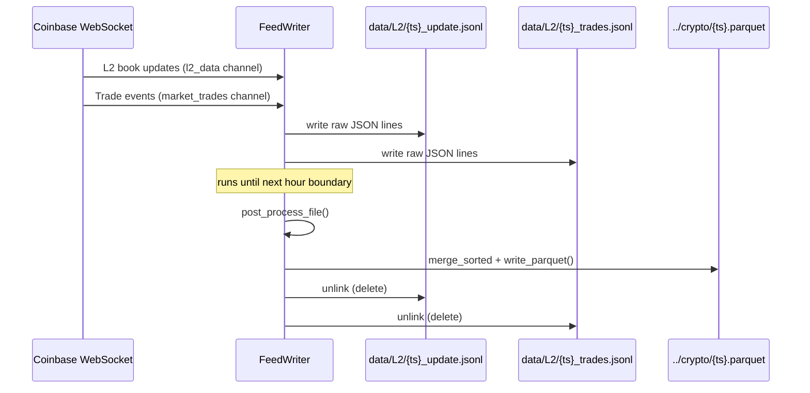
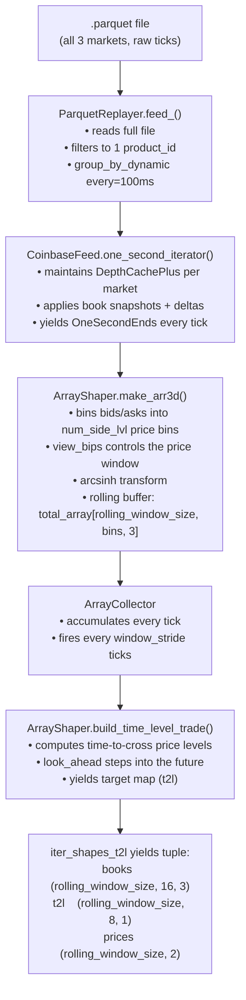
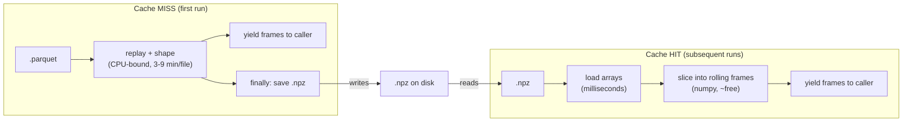
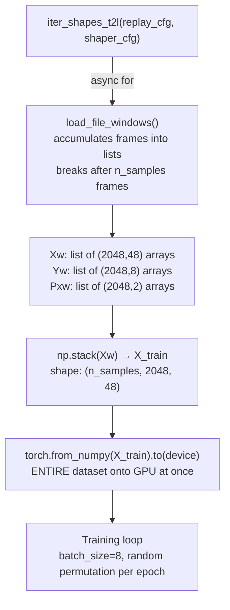
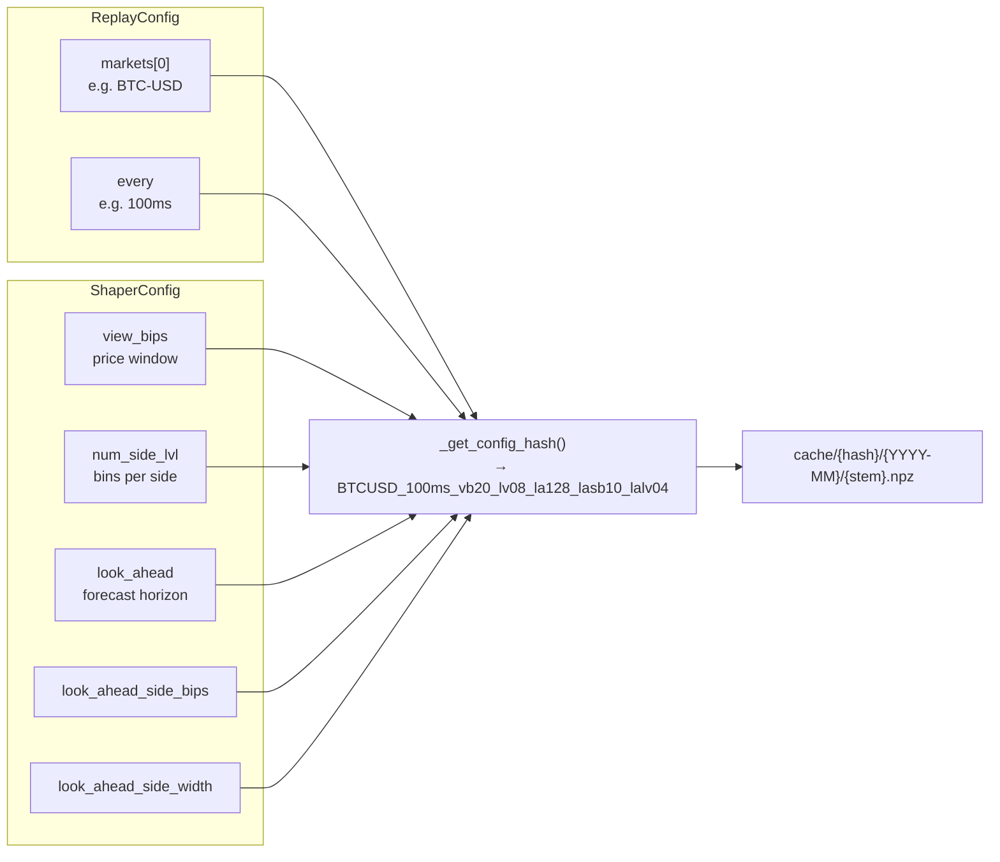
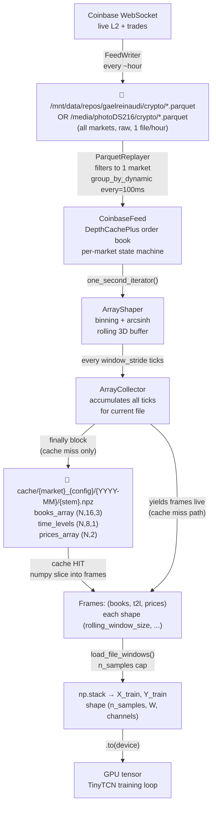

# Data Pipeline: From Recording to Neural Net

## TL;DR

```
Coinbase WS  →  .jsonl (raw)  →  .parquet (hourly, multi-market)
                                        ↓
                              ParquetReplayer (filters 1 market)
                                        ↓
                              CoinbaseFeed / DepthCachePlus (order book state)
                                        ↓
                              ArrayShaper (bin → 3D image)
                                        ↓
                          .npz cache (per-market, per-config, per-hour)
                                        ↓
                          iter_shapes_t2l yields (books, t2l, prices) frames
                                        ↓
                          np.stack → GPU tensor → model
```

---

## Stage 1 — Recording (Live)

**Code**: `deep_orderbook/consumers/recorder.py` → `FeedWriter`

**Entry point**: `deepbook record` or `python -m deep_orderbook.consumers.recorder`



**Key facts:**
- One `.parquet` file per hour (filename = UTC timestamp of recording start)
- Each file contains **ALL 3 markets mixed**: `BTC-USD`, `ETH-USD`, `ETH-BTC`
- Schema: `[channel, timestamp, sequence_num, type, product_id, price, size, side]`
- Typical size: **~12 MB / hour**, ~1.7M rows

**Where files land:**

| Location | What | Size |
|---|---|---|
| `../crypto/` = `/mnt/data/repos/gaelreinaudi/crypto/` | Live 2026 recordings | 114 files |
| `/media/photoDS216/crypto/` | NAS historical 2024–2025 | 6540 files |

---

## Stage 2 — Replay + Shaping

**Code**: `deep_orderbook/replayer.py` + `deep_orderbook/shaper.py`

**Entry point**: `iter_shapes_t2l(replay_config, shaper_config)`



**What the arrays represent:**

| Array | Shape | Meaning |
|---|---|---|
| `books` | `(W, num_side_lvl×2, 3)` | 3 channels per price bin per tick — see below |
| `t2l` | `(W, look_ahead_side_width×2, 1)` | how soon price will cross each level; larger = sooner (`5 / ticks_to_cross`) |
| `prices` | `(W, 2)` | (best_bid, best_ask) in dollars at each tick |

Where `W = rolling_window_size`. `ShaperConfig` default = **256**; experiments use `DEFAULT_SHAPER_CONFIG_2026` = **2048**.
At `every="100ms"`: 256 ticks = 25.6 s, 2048 ticks = ~3.4 min. At default `every="1000ms"`: 2048 ticks = ~34 min.

**The 3 channels in `books` (traced through `bin_books` → `make_arr3d`):**

```
Ch 0: arcsinh(bid_depth − ask_depth)   ← net signed book: positive on bid side, negative on ask side
Ch 1: arcsinh(buy_trade_volume)         ← buy-initiated trades at each price bin
Ch 2: arcsinh(−sell_trade_volume)       ← sell-initiated trades (stored as negative values)
```

The ask sizes are negated before binning (`dfa = asks.with_columns(-size)`), so bids and asks are combined
into a single signed channel. Price bins above the mid-price carry ask-side (negative) depth; bins below carry bid-side (positive) depth.

**Book state resets correctly at every snapshot event.** Each parquet file starts with a Coinbase `type="snapshot"` (full L2 snapshot) which calls `DepthCachePlus.reset(snapshot)`, wiping any stale book state. Mid-file WebSocket reconnects produce additional mid-hour snapshots (confirmed: a 1-hour file may contain 2–5 snapshot events at different timestamps, each carrying a full L2 book reset). The `process_message` match block in `CoinbaseFeed` handles all of them identically, so order book integrity is maintained after reconnects.

---

## Stage 3 — Cache

**Code**: `deep_orderbook/cache_manager.py` → `ArrayCache`

The cache stores the **raw per-tick shaped arrays** (not pre-windowed). Windowing into frames happens at load time from the cache — it's just numpy slicing, essentially free.



### Cache directory structure

```
cache/
└── {market}_{every}_vb{view_bips}_lv{num_side_lvl}_la{look_ahead}_lasb{side_bips}_lalv{side_width}/
    └── {YYYY-MM}/
        └── {original_parquet_stem}.npz
```

**Real example on disk:**
```
cache/
├── BTCUSD_100ms_vb20_lv08_la128_lasb10_lalv04/   ← after market-fix
│   └── 2026-04/
│       └── 2026-04-15T10-00-00.npz
│
├── 100ms_vb20_lv08_la032_lasb10_lalv04/           ← OLD (no market prefix!)
│   └── 2025-02/                                     ← these are all ETH-USD
│       └── 2025-02-11T04-00-11.npz
│
└── ETHUSD_1000ms_vb20_lv08_la032_lasb10_lalv04/  ← new format, ETH
    └── ...
```

> ⚠️ **Old cache dirs without market prefix** are orphaned — generated before the market-in-hash bug was fixed.
> They contain a **mix of ETH-USD and BTC-USD** with no way to tell which is which from the path alone (confirmed by sampling: `1000ms_vb05` → ETH ~$2686, `500ms_vb05` → BTC ~$74k).
> Before the fix, running the same shaper config for BTC then ETH (or vice versa) would silently serve the **wrong market's data**.
> The new code will not find these old dirs (cache miss → safe cold rebuild under the correct market-prefixed path).

### What's inside a `.npz`

```python
{
  'books_array':  shape (N_ticks, 16, 3),   # full hour of shaped order book
  'time_levels':  shape (N_ticks,  8, 1),   # precomputed t2l targets
  'prices_array': shape (N_ticks,  2),      # (bid, ask) per tick
}
# N_ticks ≈ 20,000–27,000 for a full hourly file at 100ms cadence
# (not 36,000: the replayer only emits windows that contain actual data;
#  sparse periods produce fewer 100ms buckets)
# file size: ~50–80 MB uncompressed, ~5–15 MB .npz compressed
```

---

## Stage 4 — Loading into the Neural Net

**Code**: `scripts/exp16_batch_h64_tcn.py` → `load_file_windows`



**Memory math** (the `n_samples` cap exists for this reason):

Each frame: `rolling_window_size × 16 bins × 3 channels × 4 bytes` = **0.39 MB** for X, **0.07 MB** for Y.

| `n_samples` | X (books) | Y (t2l) | Total on GPU |
|---|---|---|---|
| 48 (old default) | 19 MB | 3 MB | **22 MB** |
| 800 (exp23) | 315 MB | 52 MB | **367 MB** |
| ~4500 (full hour, stride=8) | 1.8 GB | 295 MB | **~2.1 GB** |

> OOM risk is GPU VRAM, not RAM. A full unrestricted hour lands ~2 GB of tensors on the GPU before the model, gradients, or optimizer state even exist. On a 4–8 GB card that's the whole budget.

> `DataLoaderWorker` (in `data_loader.py`) does exist and is used by `Trainer` in `learn/trainer.py` (and by `pure_attention.py`, `attention_tcn.py`). However, the active experiment scripts (`exp16`/`exp22`/`exp23`) bypass it entirely — they do the load-everything-upfront pattern. If you switch to `Trainer`-based training, the streaming path exists and the OOM risk disappears.

---

## Design Notes & Known Concerns

### TinyTCN flattens spatial structure

`exp16`/`exp22`/`exp23` use `TinyTCN`, a **1D causal TCN** on a flat 48-feature vector (`books.reshape(T, 16*3)`). The bid/ask price-level layout is destroyed before the model ever sees it. The `TCNModel` (2D causal conv) exists and would preserve spatial relationships, but is not used in the active experiment chain.

### TinyTCN receptive field is only 15 ticks

```
b1 (k=3, d=1):  +2  → RF = 3
b2 (k=3, d=2):  +4  → RF = 7   (residual with b1)
b3 (k=3, d=4):  +8  → RF = 15  (residual with b2)
```

At `every=100ms`: **15 ticks = 1.5 seconds** of actual temporal context per output tick.
Even with `rolling_window_size=2048` (204 seconds of data in the window), the model only uses the most recent 1.5 seconds of context for any given prediction. The large window is mostly wasted.

### t2l threshold-scaling creates a non-uniform "no-crossing" baseline

`t2l = 5 / (time_steps / thresh) = 5 × thresh / time_steps`

When a level is **not crossed** within `look_ahead` steps, `time_steps = 1e9` (capped) and:

```
t2l_outer = 5 × 76 / 1e9 = 3.8e-7   (outer level, thresh=76)
t2l_inner = 5 × 19 / 1e9 = 9.5e-8   (inner level, thresh=19)
```

In the never-crossing case outer levels show **4× higher t2l than inner levels** — the opposite of the physical intuition "closer levels cross sooner." The `StructuredT2LLoss` monotonicity term penalizes the model for predictions that increase toward outer levels, but the **target itself violates this constraint in quiet markets**. If >80% of training ticks show no crossing (common in stable periods), the monotonicity gradient teaches the model to predict "outer levels are more imminent" which is backwards. The fix would be to use `t2l = FUTURE / time_steps` (normalized to [0,1]) or to not divide by `thresh` in the scaling.

---

## Config → Cache Key Mapping

`ReplayConfig` and `ShaperConfig` fields that affect the cache key:



**Fields that do NOT affect the cache key** (safe to change with no cache invalidation):

- `rolling_window_size` — windowing is sliced from cached per-tick arrays at load time; t2l values are per-tick independent of window size ✓
- `window_stride` — applied at load time
- `only_full_arrays` — filtering at load time
- `randomize` — applied at yield time

> **`time_levels` is precomputed at save time** over the **full file** (~36k ticks), not per rolling window.
> This is actually *better* than the live path where t2l is computed over only the last `rolling_window_size` prices (causing edge effects at the window boundary). From cache, every tick's t2l correctly sees `look_ahead` steps of real future data.
>
> `look_ahead`, `look_ahead_side_bips`, `look_ahead_side_width` are correctly in the cache key — changing them invalidates the cache. ✓
> Changing `rolling_window_size` does **not** corrupt t2l — per-tick values are independent of how large a window you slice around them.

---

## Full End-to-End Flow


