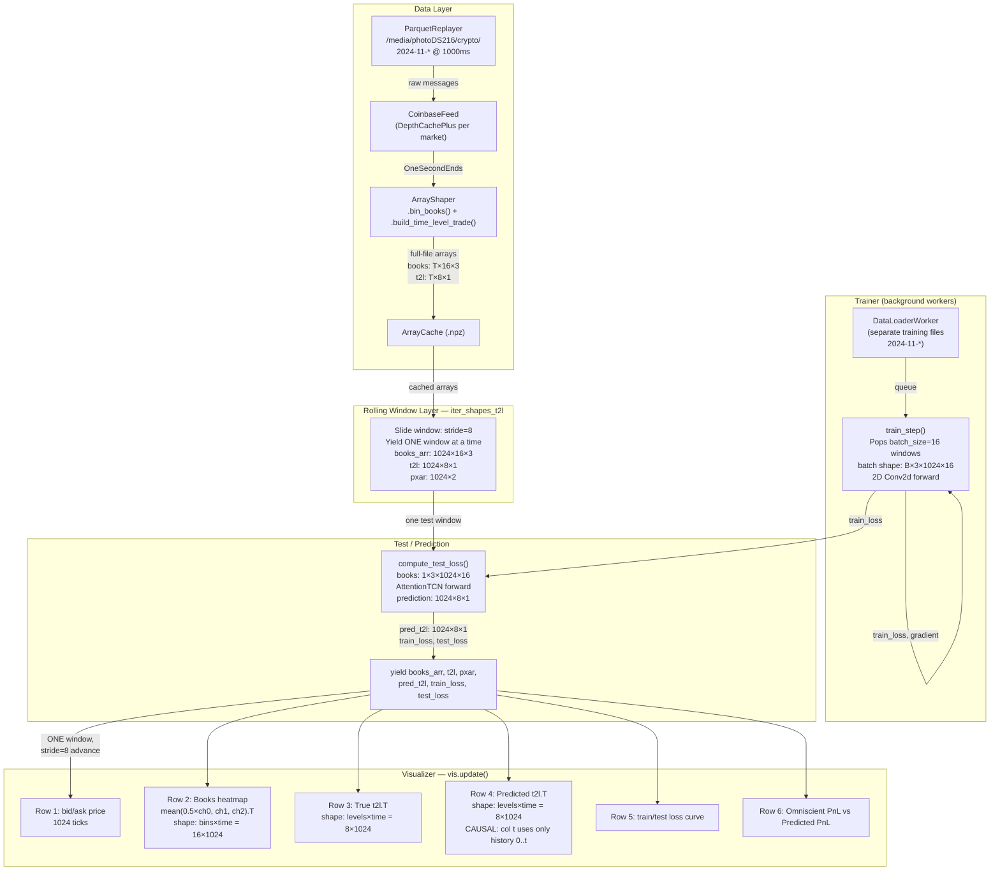
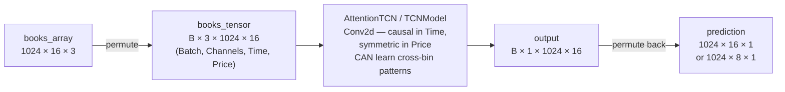
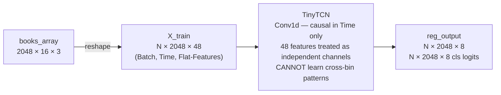
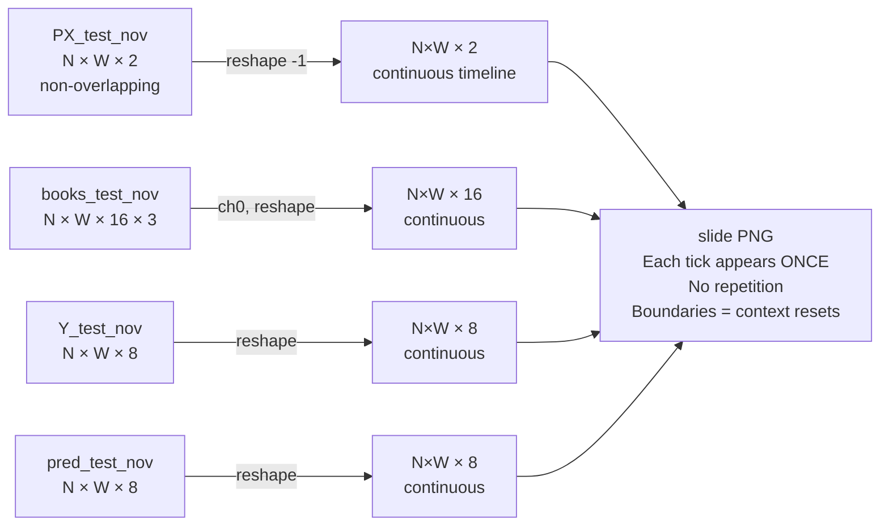

# `learn.ipynb` vs Experiment Scripts — Full Investigation

## What the Notebook Does (the Ground Truth)

### Configuration (`learn.ipynb` cell 0)

```
every = 1000ms
rolling_window_size = 1024   → 1024 s ≈ 17 min of context per window
look_ahead = 32              → 32 s forecast horizon
view_bips = 20               → wider price bins (vs 5 in 2026 experiments)
window_stride = 8
```

### Execution Flow



### What ONE visualization frame shows

Every 8 ticks (8 seconds at 1000ms), the display updates with a new rolling window:

```
x-axis = 0 .. 1023 ticks = 0 .. 1023 seconds = ~17 minutes
┌─────────────────────────────────────────────────────────────────┐
│ Row 1: bid/ask line chart — continuous price for these 1024 s   │
│ Row 2: Books heatmap (16 bins × 1024 ticks)                     │
│         ch0×0.5 + ch1 + ch2, all averaged per bin               │
│         EACH COLUMN = one 1-second snapshot of the book         │
│         BID side left, ASK side right, relative to EMA price    │
│ Row 3: True t2l   (8 levels × 1024 ticks)                       │
│         How fast did price cross each level?                     │
│ Row 4: Predicted t2l (8 levels × 1024 ticks) — CAUSAL output    │
│         Model predicts from left to right, tick by tick         │
│         Tick t can only use books[:,0:t] as context             │
│ Row 5: Loss curves (appended history)                           │
│ Row 6: PnL (strategy applied to this one window)               │
└─────────────────────────────────────────────────────────────────┘
```

### The 2D model — what the TCN actually gets



The 2D model treats the order book as a **genuine 2D image** — it can learn patterns like:
- "bin 7 bid depth rising while bin 8 ask depth falling → price move up likely"
- "wide spread between bins 5-10 → volatility incoming"

---

## What the Experiment Scripts Do (exp16 / exp22 / exp29)

### Data preparation — the FLATTEN

```python
# scripts/exp16_batch_h64_tcn.py line 707
X_train = np.stack([x.reshape(x.shape[0], -1) for x in X_train_w], axis=0)
#                   ^^^^^^^^^^^^^^^^^^^^^^^^^^^
#  books (T, 16, 3)  →  (T, 48)   — ALL SPATIAL STRUCTURE DESTROYED
```



The 1D TinyTCN treats each of the 48 features as **independent channels** and convolves only along the time axis. It cannot learn "bin 7 vs bin 8 relative changes" — it can only learn temporal patterns within each flattened feature.

### Visualization — `save_dashboard` (one frozen snapshot)

```python
# Only shows channel 0 of books (net depth), ignores ch1 (buy trades) and ch2 (sell trades)
books_show = books_array[:, :, 0].T   # shape: (bins=16, time=2048)
```

The notebook blends `mean(0.5×net_depth, buy_trades, sell_trades)`. The dashboard shows only net depth.

### New `save_sliding_inference_dashboard` (what I added today)



---

## Discrepancies Found — Sorted by Severity

### 🔴 CRITICAL: Model dimensionality mismatch

| | Notebook | Experiments (exp16/22/29) |
|---|---|---|
| **Model** | `AttentionTCN` / `TCNModel` (2D Conv2d) | `TinyTCN` (1D Conv1d) |
| **Input shape** | `(B, 3, T, 16)` — 2D image | `(B, T, 48)` — flattened vector |
| **Can learn cross-bin spatial patterns?** | ✅ YES | ❌ NO |
| **Receptive field** | 2D: temporal AND spatial | 1D: temporal only, RF=4095 ticks |

The experiment scripts throw away the 2D structure of the order book before feeding it to the model. This is the original sin. The entire point of having 16 price bins is that THEIR RELATIVE CHANGES matter — the notebook was built to exploit this with 2D convolutions.

### 🔴 FIXED: Books visualization now matches the notebook exactly

The notebook shows trades in **two layers** on the books row:
1. **Background heatmap**: `mean(0.5×ch0_net_depth, ch1_buy_trades, ch2_sell_trades).T`
2. **Scatter markers overlaid**: triangle-up (▲) at every non-zero `ch1` position (buy trades), triangle-down (▼) at every non-zero `ch2` position (sell trades)

The old dashboard only showed `books_array[:, :, 0]` (net depth only, no trade markers).

**Fix applied**: `_books_for_display()` and `_plot_books_panel()` in `exp16_batch_h64_tcn.py` now mirror `visu.py:for_image_display` exactly. Both `save_dashboard` and `save_sliding_inference_dashboard` call `_plot_books_panel(ax, books_array)` which shows the blended heatmap + buy/sell scatter markers.

### 🟡 IMPORTANT: `save_dashboard` subtitle says "ONE frozen window" but the user wants to see the sliding view

The old visualization showed one snapshot (books heatmap for one frozen rolling window). Within that one window, the EMA-relative binning makes the book look self-similar before/after a price move — this looked like a "repetition with translation."

**Fix applied today**: Added `save_sliding_inference_dashboard` that concatenates non-overlapping windows into a true continuous timeline where each tick appears once. This is now emitted as `*_slide_*.png` alongside the old `*_fixed_*.png`.

### 🟡 IMPORTANT: `window_stride` semantics

- Notebook: `stride=8` at `1000ms` → visualizer updates every 8 seconds (smooth scroll)
- Experiments: `stride=8` at `100ms` → windows advance by 0.8 seconds (very high overlap)

The experiment's `non_overlap_idx` skips `W/stride = 2048/8 = 256` windows to get non-overlapping windows. Each such window spans 2048 ticks × 100ms = 204.8 seconds. The sliding dashboard correctly shows these concatenated.

### 🟢 MINOR: `time_steps_used` truncation in Trainer

The Trainer only trains on `books[:time_steps_used]` where `time_steps_used = W - look_ahead`. This prevents the model from seeing books in the last `look_ahead` ticks where t2l is computed from "future" data beyond the window. The experiment scripts don't do this truncation — they feed the full window to TinyTCN. This is a minor inconsistency (the training targets for the last look_ahead ticks are somewhat "looser" in the experiment scripts).

---

## What I Understood, What I Did, What I Plan

### What I understood TODAY

The notebook is the **reference implementation**. It shows:
1. ONE rolling window at a time (slides by `stride` ticks per update)
2. The model gets the FULL 2D book image `(B, 3, T, bins)` — spatial structure preserved
3. The prediction is the model's CAUSAL output for that entire window (tick t uses only 0..t)
4. The visualizer shows books as a `(bins × time)` heatmap blending all 3 channels

The experiment scripts (exp16/22/29) had a **major architectural mistake**: they flattened the 2D book to 48 features and fed that to a 1D TCN. The `TinyTCN` I improved to RF=4095 is still 1D — it still cannot see cross-bin patterns.

### What I did today

I fixed the VISUALIZATION problem (the "repetition" complaint):
- `save_dashboard` now clearly labels itself as a frozen snapshot
- `save_sliding_inference_dashboard` shows the continuous sliding view where each tick appears once

### What the plan should be

1. **Migrate experiment scripts to use `TCNModel` (2D Conv2d) or `AttentionTCN`** — these are already defined in `deep_orderbook/learn/tcn.py` and `attention_tcn.py`. The notebook proved this architecture. The experiment scripts should NOT flatten the books — they should pass `(B, 3, T, 16)` to a 2D model.

2. **Fix the books channel display** — `save_dashboard` and `save_sliding_inference_dashboard` should show all 3 channels (blended like the visualizer does: `mean(0.5×ch0, ch1, ch2)`) rather than just ch0.

3. **Align configurations** — the notebook uses `every=1000ms, view_bips=20, look_ahead=32` which corresponds to the `ms1000_wide` preset in exp29 (which performed best!). This is not a coincidence.

---

## Does This Correspond to What the SKILL Says?

The SKILL mandates:
- RF ≥ 1024 ticks ✅ (enforced by `assert_min_receptive_field`)
- Never define TinyTCN in experiment scripts ✅ (canonical module in `causal_tcn.py`)
- Use `n_samples` not `max_windows` ✅

But the SKILL does NOT yet mandate:
- ❌ Use 2D model (not 1D flattened)
- ❌ Preserve spatial book structure through the model

**The SKILL needs a new section: "Use the 2D convolutional architecture — never flatten the order book".**
