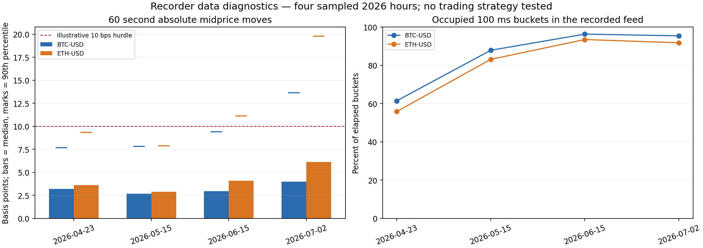

# Repository and recorder data findings

Inspected on 2026-11-18 at commit `4a26077ad4c8377438788e60f59a8c5812648bdb`, including the existing local working-tree changes. Those changes were left intact. This is a code and descriptive data audit, not a new trading experiment. One researcher performed the inspection; independent agent verification was not used.

The repository provides a substantial market-data and forecasting laboratory. Its saved records support order-book reconstruction and microstructure research. The inspected experiment evidence does not establish a profitable trading strategy.

## What the software does

| Stage | Observed behavior | Source |
|---|---|---|
| Capture | Subscribes to Coinbase `level2` and `market_trades` for BTC-USD, ETH-USD and ETH-BTC. Writes normalized JSONL, reconnects around the hour, merges the two streams into parquet, then removes the intermediate JSONL after successful conversion. | `deep_orderbook/consumers/recorder.py:61,99`; `deep_orderbook/feeds/coinbase_feed.py:136` |
| Reconstruction | Applies snapshots and absolute replacement quantities to per-market price-level dictionaries. Replays parquet into occupied time buckets. | `deep_orderbook/marketdata.py:246,252`; `deep_orderbook/replayer.py:82`; `deep_orderbook/feeds/coinbase_feed.py:237,288` |
| Representation | Creates time × price-bin × channel arrays. The channels are signed book size, BUY-coded trade volume and negative SELL-coded trade volume, transformed with `arcsinh`. Bins follow the previous EMA of a size-weighted best-quote price. | `deep_orderbook/shaper.py:64,87,133`; `deep_orderbook/marketdata.py:70` |
| Target | For each historical tick and each up/down distance, finds the first subsequent executable quote crossing within a horizon. Outputs a distance-scaled inverse crossing time. This is a first-hit surface indexed by decision time and distance, not an explicit future price path at every future offset. | `deep_orderbook/shaper.py:152` |
| Storage | Saves per-file book, target and bid/ask arrays in market/config-specific NPZ caches; slices rolling training examples from them. | `deep_orderbook/cache_manager.py:79,157`; `deep_orderbook/shaper.py:252` |
| Learning | Contains causal temporal convolutions, attention models, dense and structured losses, dashboards and experiment tracking. The active experiment chain uses a spatial 2D TCN. A locally modified notebook-oriented training path streams through `DataLoaderWorker`; older experiment scripts load stacked arrays into device memory. | `deep_orderbook/learn/tcn.py:230`; `deep_orderbook/learn/attention_tcn.py:14`; `deep_orderbook/learn/current_branch_learn.py:107`; `scripts/exp22_trigger_sweep.py:152` |
| Trade screening | Converts predicted map maxima and side differences into entry/exit rules with persistence, cooldown and maximum holding periods. Marks PnL in quote-currency units for one unit of base asset; includes crossing the spread. | `deep_orderbook/strategy_search.py:6,22` |

The inspected research path has no broker order execution, observed fills, queue model or position-sizing system. Also, the documented CLI has an entry-point mismatch: `deep_orderbook/__main__.py:32` imports a recorder `main` that is only defined inside the recorder's `__main__` guard (`recorder.py:97`). The module invocation is the implemented recording path in the inspected source.

## What is actually saved

Filename and byte inventory of both configured locations:

| Corpus | Files | Decimal GB | First dated file | Last dated file |
|---|---:|---:|---|---|
| Local recorder | 1,924 | 30.01 | 2026-04-13 22:51:51 | 2026-07-03 14:00:10 |
| NAS historical | 6,540 | 110.56 | 2024-08-04 23:00:00 | 2025-05-19 02:00:11 |

The local corpus occupies 1,922 distinct filename-hour slots, with 15 missing slots between its endpoints and two additional files within already represented hours. The historical corpus has 364 missing hour slots and 11 additional dated files within represented hours, plus one nonstandard `TOO_BIG_...` filename. These are filename coverage counts, not verified full-hour recording durations. No November data was present in these two locations. Source: [data_audit.json](data_audit.json), `inventory`.

Six hourly files were read in full: 2024-09-15 12:00, 2025-02-18 11:00, 2026-04-23 12:00, 2026-05-15 12:00, 2026-06-15 12:00 and 2026-07-02 12:00. Together they contain **15,093,184 rows**, with all three markets in each file.

All six expose the same eight logical fields: `channel`, message `timestamp`, `sequence_num`, `type`, `product_id`, `price`, `size`, `side`. Historical categorical encodings differ from current enum encodings. None of these sampled files contained null fields, negative sizes or nonpositive prices, and all were sorted by timestamp. Zero book sizes occur and represent removal of a price level. Source: `data_audit.json`, `sampled_files`; Coinbase [AsyncAPI specification](https://docs.cdp.coinbase.com/api-reference/advanced-trade-api/advanced-trade-asyncapi.json), `L2Update` (accessed 2026-11-18; no publication date supplied).

The saved data is aggregated L2 depth and public trades. The model used during recording omits individual trade IDs, trade execution times and L2 engine event times. There is no local receive timestamp, individual order identity or queue priority in these parquet samples. The retained timestamp is the WebSocket message timestamp, parsed from its UTC `Z` representation into a timezone-naive parquet datetime. Sources: `deep_orderbook/marketdata.py:24,47`; `deep_orderbook/feeds/coinbase_feed.py:171`; sampled parquet schemas.

Consequently, timing is adequate for research at seconds and longer horizons with conservative latency assumptions, but these records alone cannot measure actual end-to-end execution latency or determine a passive order's queue position.

## Reconstructed market behavior

Books were reconstructed independently per market: reset on snapshots, replace level quantities on updates, remove zero levels, then sample quotes strictly before each whole-second boundary. Idle quotes were carried forward with message age retained. No crossed-book repair was applied. There were no crossed or locked quotes at these sampled boundaries. This does not certify every intermediate event or every corpus file.

| Sampled 2026 hour | BTC median absolute 60 s move | ETH median absolute 60 s move | BTC occupied 100 ms buckets | ETH occupied 100 ms buckets |
|---|---:|---:|---:|---:|
| Apr 23, 12:00 | 3.19 bps | 3.60 bps | 61.5% | 55.8% |
| May 15, 12:00 | 2.68 bps | 2.88 bps | 87.9% | 83.2% |
| Jun 15, 12:00 | 2.96 bps | 4.11 bps | 96.3% | 93.5% |
| Jul 2, 12:00 | 3.98 bps | 6.12 bps | 95.4% | 91.8% |

These are overlapping unconditional price changes, not trade returns, independent observations or evidence of predictability. In the same four hours, ETH-BTC had just 98–480 trade-update rows per hour and median spreads of 1.07–1.49 bps. BTC/ETH USD trade counts were much higher. Source: `data_audit.json`, per-market `forward_returns`, `spread_bps`, `trade_update_rows` and `occupied_100ms_fraction`.

## Interpretation and evaluation issues in the current path

**The active 2D TCN is causal.** `ArrayShaper.make_arr3d` encodes the current book and tape using the previous EMA as the price reference. `OrderBook2DTCN` keeps price-bin structure and applies left-only temporal padding at both convolutions in every residual block. The heads pool across price without shrinking or mixing the time axis. On two 1,024-row cached BTC-USD images from the April 23 exp63 holdouts, I instantiated the `regonly_l1_2d_h8` architecture with seeded weights and checked both output heads in evaluation mode. At prefix lengths 256, 512 and 896, replacing the suffix changed later outputs and left the prefix exactly equal. Feeding the prefix alone matched within `9.54e-7`. This checks the model's dependency on future input rows and does not measure trained forecast quality. Sources: `deep_orderbook/shaper.py:64,133`, `deep_orderbook/learn/tcn.py:39,271` and `deep_orderbook/btc_search_lab.py:489`.

A separate replay check tripled reported sizes after `2026-06-15 12:00:20 UTC` in a 20-second BTC-USD excerpt. All nine valid image rows through the cutoff matched exactly in the original, perturbed and truncated runs. All ten subsequent rows changed in the perturbed run. This checks the replay group callback and image shaper from a single initial snapshot. Sources: `deep_orderbook/replayer.py:98`, `deep_orderbook/feeds/coinbase_feed.py:237` and `deep_orderbook/shaper.py:133`.

The actual convolutional receptive field is 4,093 ticks for ten blocks because each block has two dilation-`2^i` temporal convolutions. The reported field of 2,047 counts one convolution per block. The current rolling input still limits available history to 1,024 rows, so applying trained weights to a full hour in a single pass can change the prediction by providing more prior context. Source: `deep_orderbook/learn/tcn.py:22,39,248`.

1. **Trade-side semantics.** Coinbase's specification defines `MarketTrade.side` as the maker's side. Thus maker SELL corresponds to an aggressive buyer, and maker BUY to an aggressive seller. `shaper.py:109` calls BUY-coded volume `trup` and SELL-coded volume `trdn`. The channels retain information, so this alone does not invalidate a learned model, but interpreting them as aggressive buy/sell pressure reverses their meaning. Source: Coinbase AsyncAPI specification, `MarketTrade.side`; `deep_orderbook/shaper.py:109`.

2. **Sample count is not elapsed time.** Replay emits groups that contain data and does not create missing buckets (`replayer.py:98`). At 61.5% occupancy, 128 nominal 100 ms samples represent about 20.8 seconds on average, rather than 12.8 seconds. That is an average-rate illustration; each actual horizon varies. Caches store no timestamps (`cache_manager.py:147`), so their arrays do not preserve this distinction.

3. **Target scaling and censoring.** Future quotes within the label horizon are intended supervision. Crossing distances, however, use the final price in the supplied array (`shaper.py:177`), which is end-of-file price when caching. In a controlled check, changing the last quote outside a four-tick label window changed a fixed earlier label from a hit (`10.001005`) to a non-hit (`4.00e-8`). The output scales with absolute quote-currency distance and is not a probability. Future arrays are edge-padded (`shaper.py:192`), so labels near an array boundary have incomplete observation horizons. Cache generation uses full-file prices while a cache miss yields targets computed over the currently available window (`shaper.py:328`; `cache_manager.py:157`). This can change labels between first and cached passes.

4. **Test-period event selection can look ahead relative to simulated trades.** `exp22_trigger_sweep.py:123` filters whole test windows by eventfulness. That score includes return, range and volatility across each entire window (`event_selection.py:16`). The strategy then trades all rows of the selected segment (`exp22_trigger_sweep.py:287`). Information later than an early simulated trade therefore contributes to whether that segment was included. Ranking windows against other windows in the test file also uses the test distribution. Historical training-window sampling has different causality requirements from live trade eligibility.

5. **Headline sample counts exceed trading coverage.** The latest experiment artifact contains 226 and 225 retained windows in its two holdouts. With rolling length 1024 and stride 4, the non-overlap selector takes every 256th retained window, yielding only one 1024-tick segment per hour. This avoids flattening overlapping windows, but does not evaluate a continuous two-hour strategy. Sources: `pipeline_guards.py:138`; `exp22_trigger_sweep.py:163,241`; latest exp63 JSON below.

6. **Execution remains a screening approximation.** `strategy_search.py:51` decides and trades using the same tick's quotes, with no processing delay or depth-dependent execution price. Independent per-window runs reset positions. The added friction in the latest continuation is `final_pnl - trade_count * cost`, so “cost 5” is five quote-currency units per one-base-unit trade, not five bps. Sources: `strategy_search.py:63,83`; `pipeline_guards.py:239`; `scripts/exp63_active_core_recent24_short_continuation.py:62`.

7. **Cache coverage is not certified.** A caller's early break can save the collected file prefix through the generator's finalizer. Cache loading accepts the stored arrays without a full-file completion marker or raw-file fingerprint. Thus a cache hit does not by itself prove that the entire recorded hour is represented. Sources: `shaper.py:334`; `cache_manager.py:104,157`; `scripts/exp16_batch_h64_tcn.py:129`.

8. **The current notebook path calibrates its cap on held-out labels.** In the inspected working tree, `current_branch_learn.py:245` calculates the prediction cap from `y_test`, then applies it to displayed predictions and to train predictions used for route calibration. The exp22 experiment script calculates the cap from `Y_train` at `scripts/exp22_trigger_sweep.py:232`. This distinction matters when validating the notebook's outputs as trading signals.

9. **Replay can repeat old trades in later image rows.** `CoinbaseFeed.cut_trade_tape()` updates a market's cached tape only when that market has new trades, then clears the temporary accumulation. Replaying the June 15 12:00 UTC BTC-USD recording through the feed and shaper reproduced the issue at the bucket ending `12:03:20`. The parquet contained zero fresh trades for that bucket, while replay supplied six old trades and the image had two nonzero trade cells. The stale data comes from earlier ticks and distorts the meaning of the trade channels. Sources: `deep_orderbook/feeds/coinbase_feed.py:222,237,345` and `deep_orderbook/shaper.py:109,133`.

## What the saved experiments establish

The SQLite registry was opened read-only and contains 1,152 experiment rows. Its latest row is dated 2026-04-28 and summarizes exp63 on the April 23 17:00 and 18:00 holdouts. The source JSON reports mean map precision **0.6250**, F1 **0.7312**, and RMSE/zero-baseline ratio **0.9319**. Every fixed route loses before additional friction:

| Route | Raw quote-unit PnL | Entries | PnL after cost 5 per entry |
|---|---:|---:|---:|
| q95 fast | -215.75 | 16 | -295.75 |
| q90 fast | -161.47 | 35 | -336.47 |
| q90 persistence, hold96 | -176.47 | 13 | -241.47 |
| q90 persistence, fast exit | -325.45 | 15 | -400.45 |

Source: [exp63 summary JSON](../../../experiments/results/exp63_active_core_recent24_short_continuation_20260428T005729Z.json), `aggregate_results`. The summary dashboard was also inspected. The previous continuation pair had positive results for one route; the later pair reversed them. Source: corresponding `exp63_active_core_recent24_short_continuation_20260427T032726Z.json`. There is predictive-map evidence worth investigating, but no demonstrated stable trading edge in these results.

The checked-in exp64 script proposes broader training coverage; no exp64 result was found in the registry or results inventory. Its existence is not evidence that its proposed experiment completed.

## Verification scope

Ran `tests/test_strategy_search.py`, `tests/test_continuity.py`, `tests/test_trigger_search.py` and `tests/test_research_core.py`: **31 passed**. These checks cover existing helper behavior; they do not establish causality of the full research pipeline or profitability. No model was trained, no trading hypothesis was backtested, and no experiment database rows, existing caches, historical experiments or application code were changed during this audit.
